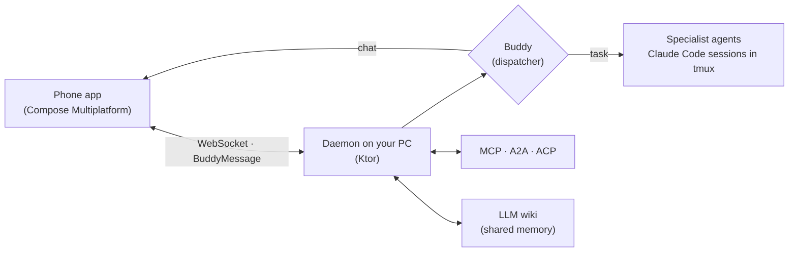

# Buddy

**A personal AI assistant that lives on your phone and runs a team of AI agents on your PC.**

You talk to Buddy. Buddy decides who does the work: it answers simple things itself and hands real
tasks to specialist agents, each a Claude Code session running on your own machine. Risky actions wait
for a tap on your phone.

> The source is private while I get it ready for open source. This repo explains what Buddy is and how
> it works. I'm building it in public on [LinkedIn](https://www.linkedin.com/in/hey-deepak).

## How it works

- **Phone ↔ PC.** One Kotlin wire protocol (`BuddyMessage`, 30+ message types) over WebSocket, on Wi-Fi,
  USB or Tailscale.
- **Buddy is the boss.** A dispatcher answers chat directly and starts a named Claude Code session for
  real work. Sessions talk to each other through MCP tools, not copy-paste.
- **You stay in control.** Three modes per workspace: plan (read-only), edit (every change asks your
  phone), unrestricted. Claude Code hooks send permission prompts to your phone.
- **It remembers.** An LLM wiki (MCP server + CLI) keeps decisions, gotchas and learnings across
  sessions, so agents don't solve the same problem twice.
- **It plugs in everywhere.** MCP server and client, an A2A agent card and JSON-RPC endpoint, and an
  ACP agent so IDEs can talk to it.

## Specialist agents

Each agent is a plain Claude Code agent file with its own rules. Buddy hires the right one for the job.

- **Resume Builder.** Keeps a resume true to the user's real work: it measures authorship from git,
  never upgrades "designing" to "shipped", and fits the edits on one A4 page.
- **Social Media Manager.** Keeps LinkedIn, GitHub and job-site profiles telling the same story as the
  resume. It drafts before/after text and changes nothing without your go.
- **Builder, deployer, debugger.** Gradle, ADB and git as direct tools, for when no conversation is
  needed.

## Built with

Kotlin everywhere: Kotlin Multiplatform, Compose Multiplatform (Android, iOS, desktop, web), Ktor,
Koog, Koin, Exposed, kotlinx.serialization. Claude Code (agents, hooks, MCP), A2A, ACP, tmux.

| Module | What it does |
|---|---|
| `daemon` | The brain: Ktor server, dispatcher, sessions, MCP/A2A, relay for Claude Code hooks |
| `composeApp`, `app` | The phone app (plus desktop and web) |
| `shared` | Wire protocol and models (KMP) |
| `buddy-cli` | Starts AI tools in managed tmux sessions |
| `acp-agent` | Lets IDEs talk to the daemon |
| `llm-wiki` | The shared knowledge base (MCP server + CLI) |

## Status

Daily driver for one user (me). Open source is planned once the history is cleaned up.

— Deepak Choudhary · [LinkedIn](https://www.linkedin.com/in/hey-deepak) · [GitHub](https://github.com/Hey-Deepak)
