# Buddy

**A personal AI assistant on my phone that runs a team of AI agents on my Mac.**

I talk to Buddy. Buddy decides who does the work: it answers simple things itself and hands real
jobs to specialist agents, each one a Claude Code session on my own machine. The agents write code,
write posts, find work, track my food and remember what they learn. Anything that leaves my
machine waits for my tap.

  <a href="https://hey-deepak.github.io/Hey-Buddy/assets/film/hey-buddy-film.mp4">
    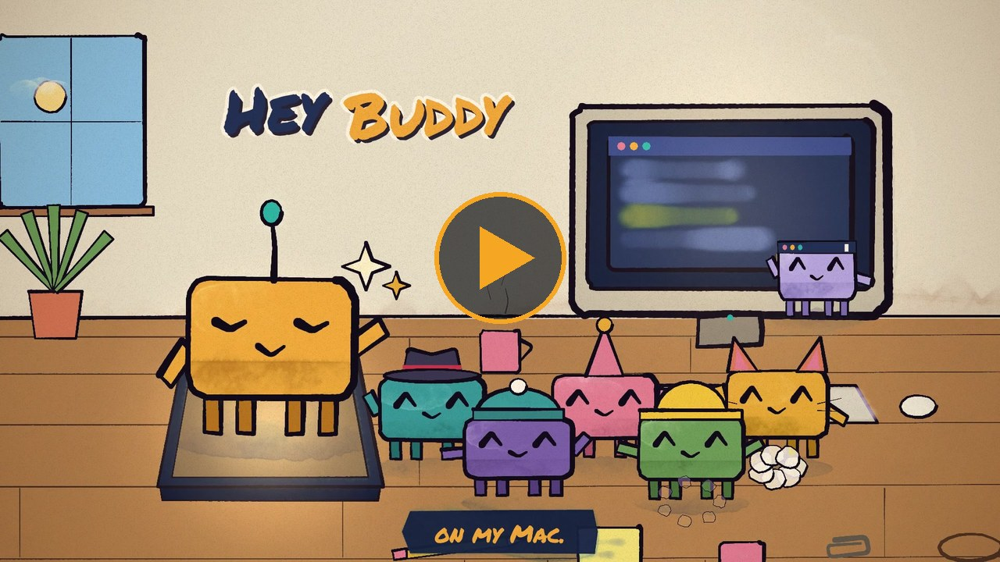
  </a>

<a href="https://hey-deepak.github.io/Hey-Buddy/assets/film/hey-buddy-film.mp4"><b>▶ Watch the 3-minute film</b></a> What Buddy is, how it got here, and a normal day with it.

  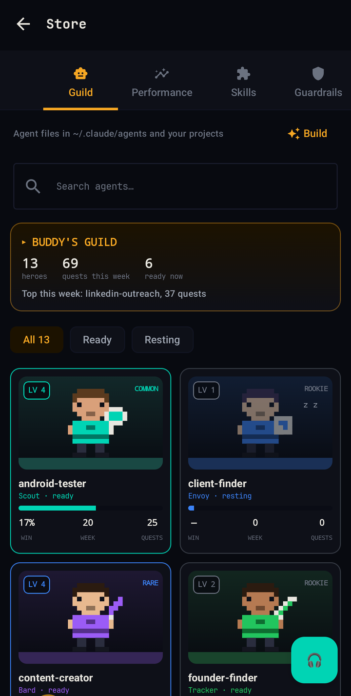

The team, as the phone shows it. Every screenshot here is the real app on my phone.

> The code is private, and that is on purpose: a personal assistant that really works ends up
> full of its owner's life. This repo shares what Buddy does, how it is built and what I learned,
> so you can build your own. I post the lessons on [LinkedIn](https://www.linkedin.com/in/hey-deepak).

## A day with Buddy

1. **Morning, on the phone.** I open the chat and ask "what is the update?". Buddy tells me which
   sessions finished overnight and which ones are waiting on me.
2. **On a walk, by voice.** I call Buddy and talk. It sends my words to the right session and
   reads the answer back, so I never look at the screen.
3. **A session gets stuck.** A Claude Code session in my terminal has a question. The card shows up
   on my phone with the choices, I tap one, and the session carries on. If I want to see more, I
   open the session as the live terminal or as a chat.
4. **Lunch.** I send a photo of my plate to the Fitness chat. It logs the meal and tells me what to
   eat next to reach my protein for the day.
5. **Evening.** The content agent has a post ready with its image. I read it and tap "Post now".
6. **Night.** The job and outreach agents keep checking for replies. The wiki tidies itself. In the
   morning it starts again.

## What it does

<table>
  <tr>
    <td width="33%">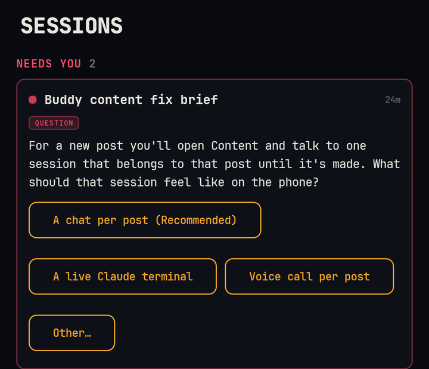</td>
    <td width="33%">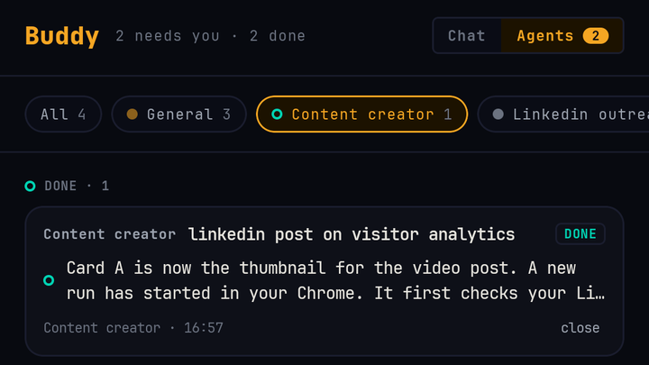</td>
    <td width="33%">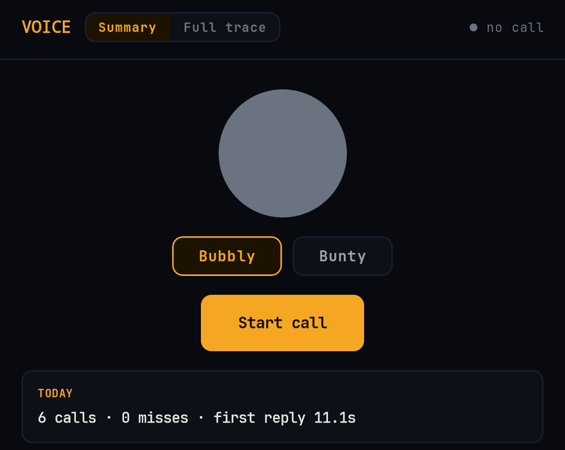</td>
  </tr>
  <tr>
    <td valign="top"><b>Terminal.</b> Every Claude Code session on my Mac is on my phone. I can watch a session exactly as it looks in the terminal, or switch the same session to a chat view. Questions and permission prompts arrive as cards I can answer.</td>
    <td valign="top"><b>Agents.</b> Buddy starts a session for each real job and tells me when it is done or needs me.</td>
    <td valign="top"><b>Voice.</b> A phone call with Buddy. It routes what I say, reads replies aloud and asks before anything goes out.</td>
  </tr>
  <tr>
    <td>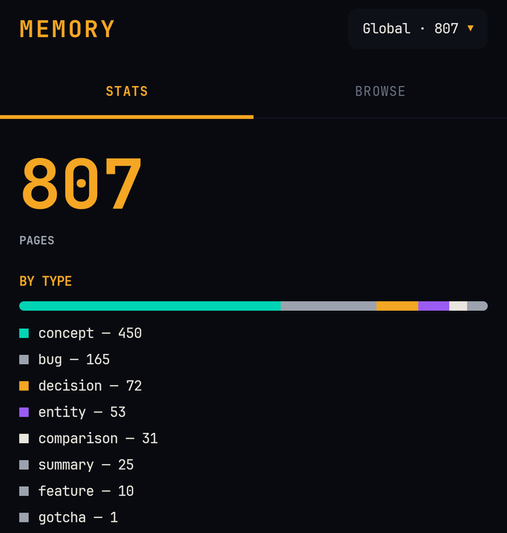</td>
    <td>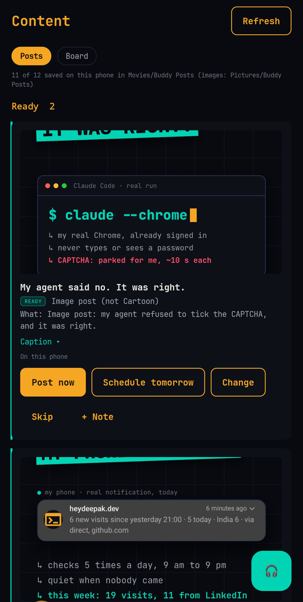</td>
    <td>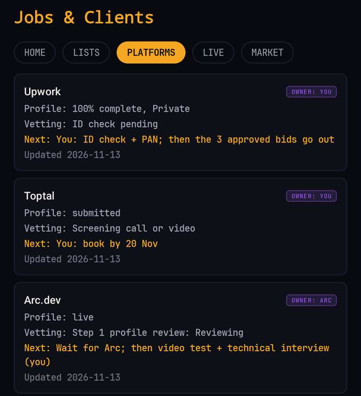</td>
  </tr>
  <tr>
    <td valign="top"><b>Memory.</b> A wiki every session reads and writes: decisions, bugs, gotchas. Buddy can also interview me to fill in what it doesn't know, and it tidies the wiki every night.</td>
    <td valign="top"><b>Content.</b> The content agent turns my real work into a post with its image or video. I pick Post now, Schedule or Change.</td>
    <td valign="top"><b>Jobs & Clients.</b> Agents search, apply, track replies and draft follow-ups. The tab shows where each platform stands and what only I can do.</td>
  </tr>
</table>

Also in the app, shown here in words because the screens are personal:

- **Fitness.** A private chat that logs meals from a photo or a sentence, tracks calories and
  protein against my targets, plans workouts and nudges me in the evening.
- **Style.** A private chat that knows my measurements from a phone scan, suggests outfits from
  real shops and stops at the cart. I like or skip each one and it learns.
- **Store.** Every agent, skill and guardrail on my machine in one place. A separate Claude judge
  grades each agent run against that agent's own success rule, and I can overrule it.
- **Outreach.** Between posts, an agent comments on fresh posts in my field, answers replies and
  suggests people to connect with. A second agent researches founders using only public pages.
- **Ideas.** I drop an idea in one line. Buddy sorts it into do now, schedule, delegate or drop,
  with a line on how useful it is, so my backlog filters itself.
- **Resume.** One agent keeps my resume true to my git history and checks every claim.
- **Website.** The website builder built my portfolio, [heydeepak.dev](https://heydeepak.dev), and
  keeps it in step with the resume.
- **Social media manager.** Keeps my LinkedIn, GitHub and job-site profiles telling the same story
  as the resume. It drafts before and after text and changes nothing without my go.
- **Insta manager.** Posts what I drop in a phone folder, with captions, cover and a privacy check,
  and makes the edits. It also makes videos.

## What it has done for me

- **Code ships while I'm away from the desk.** I answer a session's question from my phone and it
  keeps building. Buddy's own features get built this way.
- **Nothing gets solved twice.** A fix or a decision from one session is in the wiki for the next.
- **It keeps me posting.** The post, the image and the video are ready before I think about them.
- **Real connections made.** Outreach connected me with many people in my field. A founder-finder
  agent picks out the founders worth talking to, so the warm leads come to me. I call them the
  fishes in the net.
- **It got me an interview.** The Job Agent applied on my job sites while I slept and watched for
  replies. One reply was a referral offer, and that referral became an interview. The interview
  showed me what to practise, so Buddy got an Interview Coach.
- **My portfolio is live.** The website builder made heydeepak.dev from my resume and keeps the
  two in step, and my profiles say the same thing everywhere.
- **A wedding surprise.** The Insta manager made a reel for a friend's wedding from start to
  finish: it downloaded the clips, edited them, uploaded the reel and tagged everyone. He did not
  see it coming.
- **Ideas don't get lost.** I capture them in a line and Buddy tells me which ones to act on.
- **I know what I ate.** Logging a meal is one photo, so I actually do it.

## How it got here

The first commit was in February 2026. This is the path from there to here, read from the git history.

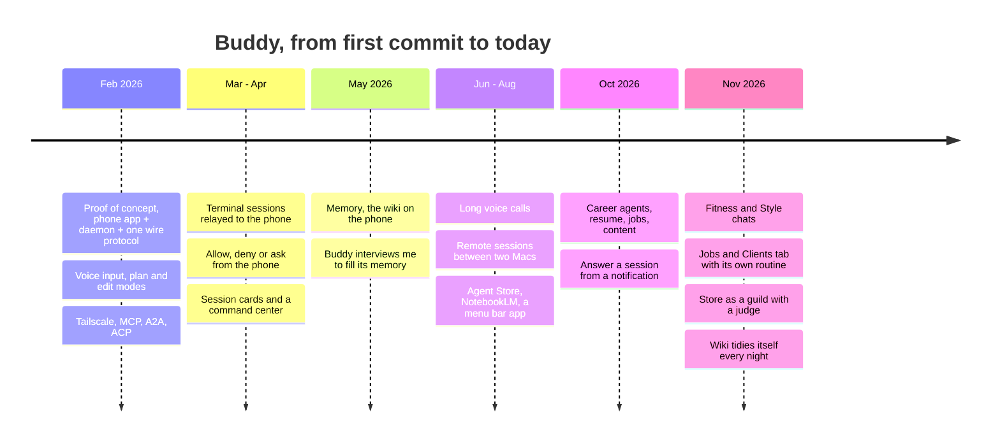

It started as a way to drive coding sessions from my phone. Then the sessions needed memory, so
the wiki came. Talking was faster than typing, so voice came. Once the sessions could be trusted
with code, I gave them the rest of my work: posts, outreach, job search, food, clothes.

## The team

Each agent is a plain Claude Code agent file with its own rules. Buddy picks the right one.

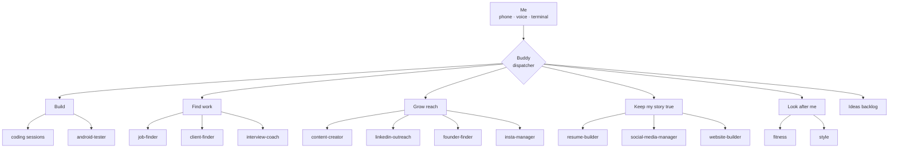

## How it works

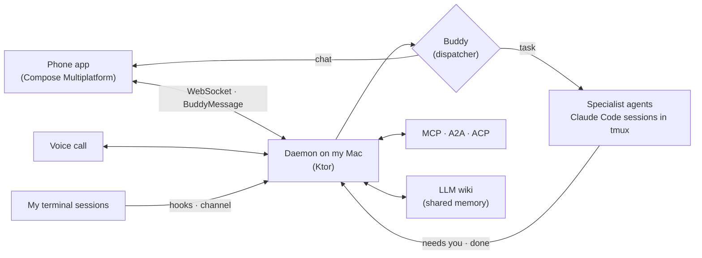

- **Phone ↔ Mac.** One Kotlin wire protocol (`BuddyMessage`, 160+ message types) over WebSocket.
  The daemon accepts only this Mac and my private Tailscale network.
- **Buddy is the boss.** A dispatcher answers chat itself and starts a named Claude Code session
  for real work. Sessions talk to each other through MCP tools, not copy-paste.
- **I stay in control.** Four modes per workspace: plan, edit, autonomous and unrestricted. Pushes
  and commits to the main branch are blocked in every mode. Outgoing emails and messages are
  drafts until I approve them.
- **Private stays private.** Fitness and Style skip the dispatcher. Each turn is its own isolated
  Claude run, and the data never leaves a folder on my Mac.
- **It plugs in.** MCP server and client, an A2A agent card and JSON-RPC endpoint, and an ACP agent
  so IDEs can talk to it.

## Built with

Kotlin everywhere: Kotlin Multiplatform, Compose Multiplatform, Ktor, Koog, Koin, Exposed,
kotlinx.serialization. Claude Code (agents, hooks, MCP), A2A, ACP, tmux.

| Module | What it does |
|---|---|
| `daemon` | The brain: Ktor server, dispatcher, sessions, MCP/A2A, relay for Claude Code hooks |
| `composeApp`, `app` | The phone app |
| `shared` | Wire protocol and models (KMP) |
| `buddy-cli` | Starts AI tools in managed tmux sessions |
| `acp-agent` | Lets IDEs talk to the daemon |
| `llm-wiki` | The shared knowledge base (MCP server + CLI) |

## Build your own

The biggest thing I learned: anyone who wants a personal agent can build one, and it should be
their own. Mine works because it knows my resume, my rules, my food and my friends. Yours would
know yours. That is also why I can't hand over the code.

What carries over is the shape:

- A daemon on your own machine, and a phone app that talks to it.
- One dispatcher that hands real work to specialist agents, each a plain agent file with rules.
- A shared memory every session reads and writes.
- A rule that anything going out waits for your tap.

It never stops changing. Every week of using it brings a new idea, and the idea becomes a new
agent or a new rule. Building software this way, with agents doing the work and me steering, is
what I write about.

## Status

Daily driver for one user (me), and still evolving. The code stays private because it is personal.
If I share code one day, it will be a separate, clean sample project, not this one.

— Deepak Choudhary · [LinkedIn](https://www.linkedin.com/in/hey-deepak) · [GitHub](https://github.com/Hey-Deepak)
